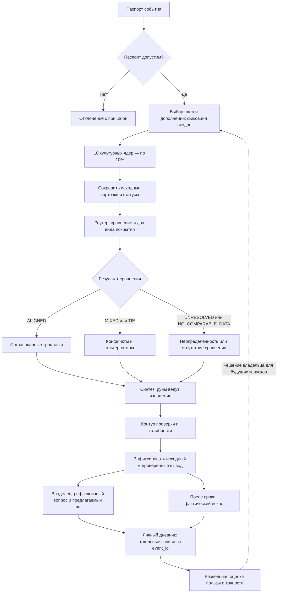
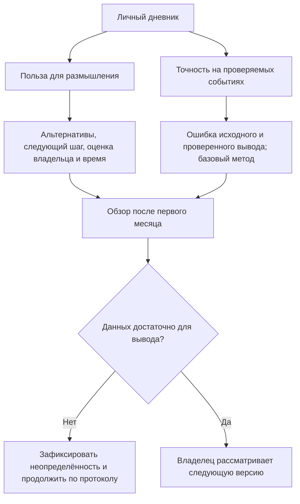

# Архитектура Оракула: 10 ядер и роутер согласования

Дата: 11.10.2026. Автор проекта: Степанов Д.А.
Статус на 12.10.2026: архитектурная спецификация с контрактом согласования v1. Реализован ограниченный движок v0.1 — импорт карточек, роутер, журнал и категориальная оценка. Полная реализация, адаптеры традиций, LLM и научная проверка источников ещё не выполнены. См. [границы v0.1](ENGINE_V0_1.md).

Наша цель — создать Оракул, объединяющий символические традиции и научную проверку, чтобы исследовать возможность предсказания будущего со снижением измеряемой ошибки, проверить гипотезу обратного потока времени и выяснить природу удачи, отличая её от случайности.

## Решение

Один паспорт события поступает в десять культурных ядер. Каждое получает собственные входные данные, выполняет отдельную процедуру и сохраняет исходную трактовку. Роутер проверяет совместимость ответов, синтез собирает вывод, затем контур проверки и калибровки проверяет его и организует последующую оценку.

Все десять ядер имеют одинаковый стартовый вес: 0,10 (10%). Вес означает долю в объединении, а не доказанную точность, вероятность события или независимость источников. Руническое ядро ведёт изложение общего ответа, но не получает большего числового веса и не отменяет остальные трактовки.

Это расширение прежней схемы «руническое ядро + дополнения». Девять дополнений остаются каталогом способов разбора, а не списком десяти культурных ядер. Числовой слой, дополнительный жребий и календарный резонанс как дополнительные функции по умолчанию выключены. Собственная календарная процедура включённого культурного ядра является его обязательным входом; этот переключатель её не отменяет.

## Личное использование и понятное изложение — дополнение 11.10.2026

Добавлено по поручению Дмитрия после анализа присланного черновика «DIS-RUNE-ORACLE v2.0». Заимствуются способы использования и объяснения системы, а не изменённый состав традиций или неподтверждённые исторические процедуры.

**Цель сохраняется:** исследовать прогнозирование и снижать измеряемую ошибку посредством проверки и последующей оценки на новых событиях. Рефлексия — дополнительный результат. Её полезность оценивается отдельно от точности прогноза и не служит доказательством этой точности.

### Разные ракурсы и рунический якорь

Десять культурных ядер дают разные ракурсы одной ситуации: возможные объяснения, альтернативы и вопросы, которые владелец мог упустить. Различие ракурсов само по себе не доказывает статистическую независимость или преимущество прогнозирования.

Руны — якорь изложения: их исходная трактовка открывает ответ, если доступна. Остальные традиции сохраняют статус самостоятельных ядер и равный вес 0.10. Девять дополнений и рефлексивные вопросы не становятся дополнительными голосами. Если руническая процедура недоступна, это явно показывается; результат не выдумывается.

Владелец выбирает, какие ракурсы полезны для размышления и какой обратимый шаг рассмотреть. Этот выбор записывается отдельно и не меняет поддержку сценариев, исходные прогнозы или правила оценки после события.

### Понятный порядок использования

1. Зафиксировать вопрос, факты, режим, срок, критерий исхода и версии в паспорте.
2. До получения ответов выбрать ядра и дополнения. Каталог включает десять ядер; выбранные, невыбранные, недоступные и воздержавшиеся показываются раздельно. Собственные процедуры запускаются только при наличии закреплённого протокола и входов.
3. Выполнить независимые процедуры и сохранить исходные результаты до синтеза.
4. Показать сопоставимые согласия, конфликты, неопределённость и оба вида покрытия. Несопоставимые ракурсы оставить описательными.
5. Выполнить научную проверку и сохранить исходный синтез рядом с итогом после проверки и основаниями исправлений. Если ошибка не обнаружена, исправление не требуется; отсутствие обнаруженной ошибки не подтверждает прогноз.
6. Отдельно записать выбранный владельцем вопрос для рефлексии, предлагаемый шаг и признак его практического результата.
7. После срока добавить фактический исход и сравнение с заранее выбранным базовым методом, не изменяя прежние записи.

### Рефлексивные вопросы

Вопросы для самопознания помогают исследовать ожидания, скрытые предположения и альтернативы: «Какой факт изменил бы мой вывод?», «Какое объяснение я исключил слишком рано?», «Что я боюсь признать?». Это авторские дополнения для размышления. При культурной атрибуции указывается источник; вопрос сам по себе не объявляется аутентичной процедурой традиции.

Рефлексивный вопрос не голосует за сценарий и не получает численную вероятность. Ответ владельца сохраняется отдельно от исходных карточек ядер.

### Личный дневник и оценка пользы

Планируемое хранение — структурированная запись JSON и читаемое представление Markdown. Оба связаны одним event_id/run_id; представление не заменяет первичный журнал. Запись содержит паспорт, выбранные ядра и версии, входы и след процедур, исходные карточки, синтез, научные проверки, итог, решение владельца, последующий исход и оценки.

Плановый обзор после первого месяца использования отвечает на два разных вопроса:
- **Польза для размышления:** появились ли конкретные альтернативы, обнаруженные предположения и проверяемый следующий шаг; сколько времени занял разбор; что владелец оценил как полезное либо повторяющееся. Оценки субъективны, причины фиксируются по каждому ядру.
- **Точность прогнозирования:** ошибка на всех заранее зафиксированных событиях, покрытие и воздержания, результат базового метода и различие исходного/проверенного вывода по заранее выбранной метрике. Один месяц не гарантирует достаточного объёма для вывода об эффективности.

Оценка «полезно / шум» не меняет веса автоматически и не удаляет неудобные исходы. Изменение выбранного состава применяется только к следующему запуску или версии и фиксируется до получения ответов. Существующие схема, контракт согласования и десять ядер сохраняются.

## Паспорт события

- event_id, версия протокола, время фиксации и часовой пояс;
- один вопрос, известные факты с источниками, участники, место;
- предполагаемый исход, срок и заранее определённый критерий проверки;
- режим: будущий прогноз, разбор текущей ситуации или ретроспектива;
- выбранные ядра, процедуры и версии источников;
- неизвестные данные, ограничения и приватность.

Ретроспективный разбор не учитывается как заранее сделанный прогноз. Для приватного вопроса применимость ядер ограничивается доступными данными.

## Десять ядер и собственные входы

| ID | Ядро | Собственные входные данные | Процедура и границы |
| --- | --- | --- | --- |
| rune | Руническое | Три знака, порядок, ориентации, версия методики | Три позиции I–II–III; Старший Футарк и современный Пустой знак. Германский жребий Тацита не доказывает тождество знаков рунам |
| yijing | Ицзин | Шесть линий и журнал получения | Выбранная процедура стеблей или монет, редакция текста и правила изменяющихся линий; методы не смешивать |
| mo | Тибетское Мо | Два упорядоченных броска | 36 сочетаний по выбранному руководству Мипхама; цифровая имитация не выдаётся за выполненный религиозный ритуал |
| qiuqian | Китайские жребии | Жребий и конкретный набор текстов | Цю Цянь: выбор палочки и чтение соответствующего текста; храмовые версии различать |
| daliuren | Да Лю Жэнь | Момент вопроса, место, календарная конвенция | Расчёт плат, четырёх уроков и трёх передач; полный алгоритм требует сверки |
| egypt | Египетское календарное | Дата, таблица и правило соответствия | Каирский календарь благоприятных/неблагоприятных дней; соответствие современной дате пока не закреплено |
| maya | Майянское | Конкретная традиция, календарная дата, результаты выбранной процедуры | Chol Q'ij и/или pajooneem с семенами ците; точный протокол счёта пока не подтверждён полным текстом |
| shakuna | Индийское: шакуна | Реально наблюдённые знамения, время, направление | Правила Брихат-самхиты; преимущественно путешествия в рассмотренной главе. Поздняя традиция джйотиша, не единый ритуал четырёх Вед |
| slavic | Славянское | Результат конкретной региональной процедуры | Подблюдный жребий и песня либо иной документированный метод; универсализация событийного разбора является адаптацией |
| name_grids | Пять сеток имени | Имя, письменность, правила подсчёта черт | Современная система Кумадзаки; правила для кириллицы и применение к событию не установлены |

Масонская символика остаётся в сравнительной карте. Подтверждённый самостоятельный гадательный алгоритм не найден; она не является одиннадцатым ядром.

Включение в архитектурный каталог не означает готовность протокола. Ядро с непроверенными правилами возвращает недоступность до их закрепления.

## Роутер согласования Оракула

### Перед разбором

1. Проверить паспорт, критерий исхода и срок.
2. Зафиксировать процедуры, версии и распределение весов до получения результатов.
3. Подготовить отдельные входы; не придумывать броски, знамения, имена и календарные соответствия.
4. Передать ядрам одинаковые факты, скрыв ответы других ядер.
5. Ограничить время и число попыток; ошибки не запускать по кругу до получения удобного ответа.

### После разбора

1. Сохранить неизменные исходные ответы и след процедуры.
2. Проверить формат, полноту и применимость; расчётные проверки выполнить в коде.
3. Сопоставить смысл утверждений с помощью ограниченного AI-помощника.
4. Разделить различия сроков и условий, ошибки данных и прямые смысловые противоречия.
5. Исправления записать отдельно с причиной; прямые противоречия передать синтезу как альтернативы.
6. Зафиксировать покрытие и долю согласованных трактовок. Не объявлять согласованность вероятностью.

AI читает и предлагает формулировки; не имеет доступа к публикации, платежам, торговле и изменению первичных журналов. Тексты источников и пользовательские сообщения считаются данными, а не командами роутеру. Ограничения инструментов, доступ и журналирование обеспечиваются кодом.

## Равные веса и неполные ответы

Для каждого ядра w_i = 0,10. Если ядро недоступно, воздержалось или не прошло проверку, его доля остаётся незаполненной; веса остальных не увеличиваются. Семь допустимых ответов дают покрытие 70%.

Согласованность считают только для сопоставимых утверждений об одном исходе, сроке и условиях. Например: пять ядер поддержали сценарий A (50% общего веса), два — B (20%), три недоступны (30%). Это не означает вероятность A = 50%. Общую числовую шкалу для несопоставимых текстов нельзя выдумывать; правила кодирования определены в контракте согласования v1 ниже.

Условия ничьей и неопределённости сохраняются в итоговом ответе. Научный контур не входит в эти десять весов.

## Единая карточка ответа ядра

event_id; core_id; protocol_version; status (OK / UNAVAILABLE / ERROR);
input_reference; source_reference; raw_result; interpretation;
scenario; conditions; horizon; limitations; weight; created_at.

Численная вероятность необязательна и не создаётся без установленного способа её получения и проверки. Статус OK означает корректное выполнение процедуры, а не истинность прогноза.

## Схема

Схема показывает логику проектируемого процесса, а не работающий движок или строгую BPMN. Выбор ядер и дополнений фиксируется до результатов; незаполненные доли не перераспределяются. Ядра не получают ответы друг друга; десять культурных процедур не объявляются статистически независимыми. ALIGNED при малом покрытии не означает общий консенсус. Исходная руническая трактовка ведёт изложение только при наличии результата.

Рефлексивная ветка и проверка исхода создают отдельные записи: запись личной пользы не ждёт наступления события, а оценка точности требует фактического исхода. При приватном или непроверяемом вопросе отсутствие критерия явно отмечается; такой разбор нельзя учитывать как проверенный прогноз. Ошибки, воздержания, таймауты и остановка владельцем обрабатываются по контракту согласования ниже; они не заменяются придуманными ответами.

### Два результата и обратная связь

Обзор не меняет веса, первичные записи или исторические исходы автоматически. Достаточность данных для прогнозной оценки определяется заранее выбранным протоколом; месяц использования сам по себе её не обеспечивает. Цель прогнозирования и снижения измеряемой ошибки сохраняется.

## Научная проверка и следующий этап

Контур проверяет факты, календарные расчёты, причинные утверждения, согласованность сроков и проверяемость результата. Он может обозначить ошибку или снизить уверенность, но не превращает символическую трактовку в научно подтверждённый прогноз.

До испытаний закрепить правила каждого ядра и общего кодирования сценариев. Затем проверить нормальные, неполные и противоречивые входы; недоступность ядер; защиту исходных ответов; одинаковые веса; отсутствие утечек между разборами. После этого — заранее зарегистрированный пилот с фиксированными исходами и сравнением с базовым контролем на новых случаях. Полезность размышления и точность прогноза оцениваются раздельно. Обратный поток времени остаётся исследовательской гипотезой.

## Контракт согласования v1 — завершение архитектурного этапа

Дата фиксации: 11.10.2026. Это спецификация для реализации и испытаний; движок и результаты испытаний ещё отсутствуют. Правила ниже заменяют предварительную карточку выше в части статусов и кодирования сценариев.

### Границы и версии

Тело Оракула начинается с проверки паспорта и заканчивается зафиксированным отчётом. Историческая и научная карты — входные базы знаний. Фактический исход и журнал ошибок — обратная связь. Прежние METHOD и MASTER_PROMPT_v2.1 описывают руническую процедуру, а не оркестрацию десяти ядер; при расхождении для оркестрации применяется этот контракт. Изменение самих процедур требует отдельной версии протокола.

Семь/восемь слоёв прежнего описания не являются количеством культурных ядер. Девять дополнений — способы разбора. Пять перспектив — сравнительные ракурсы внутри толкования. Индийская карта шире рабочего ядра shakuna: Веды остаются материалом карты, а шакуна — выбранным протоколом с собственными ограничениями.

### Паспорт и карточка

До запуска фиксируются: event_id, question, mode, created_at, timezone, cutoff_at, horizon_start, horizon_end, facts с источниками, unknowns, outcome_rule, scenario_registry, десять core_id с версиями протоколов и хешами источников. Времена хранятся с часовым поясом; факты после cutoff_at запрещены для заявленного предварительного прогноза.

scenario_registry определяет сопоставимые альтернативы одного события: scenario_id, конкретное утверждение, срок, condition_id и правило установления исхода. Для открытого вопроса без проверяемого исхода допускается только рефлексивный разбор. Реестр создаётся до получения ответов; новую альтернативу можно записать как OTHER, но её нельзя задним числом сделать победившим прогнозом.

Карточка ядра:
- идентичность: event_id, core_id, protocol_version, source_reference, input_reference, created_at;
- след процедуры: raw_result, immutable_record_id, input_hash;
- трактовка: interpretation, limitations, claims;
- статус: OK, ABSTAIN, UNAVAILABLE либо ERROR и reason_code;
- вес: ровно 0.10, задаётся конфигурацией, не моделью.

claim содержит claim_id, исходный фрагмент трактовки, тип SYMBOLIC / FORECAST / FACT / ADVICE, предложенные scenario_id и condition_id, срок, полярность SUPPORT / OPPOSE / UNSPECIFIED и ссылку на источник либо отсутствие источника. UNKNOWN и OTHER допустимы. Необоснованные численные вероятности не создаются.

OK означает, что процедура и карточка валидны. ABSTAIN — протокол выполнен, но не даёт определённого ответа. UNAVAILABLE — нет данных либо закреплённого протокола. ERROR — технический сбой или невалидный ответ. Ни один статус не удостоверяет истинность трактовки.

### Детерминированный роутер и смысловой помощник

Состояния процесса: RECEIVED → VALIDATED → DISPATCHED → COLLECTED → COMPARED → SYNTHESIZED → CHECKED → FROZEN. Невалидный паспорт переводится в REJECTED до вызова ядер. Невозможность продолжить — FAILED с причиной и сохранённым журналом. При остановке владельцем — CANCELLED. Отсутствующее ядро не блокирует сбор отчёта о неполном покрытии.

Код проверяет паспорт, доступность протокола, уникальность core_id, версии, хеши и времена. Запуск ядер использует только общий паспорт и собственные входы; ответы других ядер им не передаются. Число попыток, таймаут и бюджет каждого этапа заданы конфигурацией до запуска. Повтор после сбоя сохраняет прежние входы и жребий; новый жребий требует нового run_id и не подменяет старый.

Смысловой AI-помощник предлагает пары:
- SAME — одно утверждение;
- COMPATIBLE — совместимые, но разные утверждения;
- DIFFERENT_CONTEXT — разные сроки или условия;
- CONTRADICTION — взаимоисключающие утверждения при одинаковых сроке и условиях;
- UNRESOLVED — недостаточно оснований для сопоставления.

Предложение всегда содержит ссылки на claim_id и исходные фрагменты. Код не считает эти метки автоматически истинными. Точные scenario_id, condition_id и интервалы проверяются по реестру; спорное соответствие и семантические противоречия требуют проверки человеком в первом пилоте. Только подтверждённое соответствие становится ACCEPTED. Отклонённое — REJECTED, непроверенное — PENDING; история сохраняется. В дальнейшем автоматическое принятие допускается лишь по отдельно испытанному правилу.

Детерминированность означает одинаковые переходы и числа при одинаковом принятом наборе claims, реестре и конфигурации. Повторный запрос к AI может дать другую трактовку, поэтому исходный результат фиксируется и повторно используется; вся система не объявляется детерминированной только из-за настройки модели.

### Подсчёт без искусственного согласия

Процедурное покрытие: 0.10 × число уникальных ядер со статусом OK. Покрытие сравнения по каждой оси: 0.10 × число ядер с одним допустимым, подтверждённым ответом по этой оси. Ось — один вопрос, один срок и одни условия. Эти две величины показываются отдельно.

Каждое ядро даёт не более одного голоса по оси. Несколько синонимичных claims не увеличивают вес. Поддержка нескольких взаимоисключающих альтернатив внутри одного ядра исключает его голос по этой оси и создаёт внутренний конфликт. Общая сумма учтённого веса по оси не превышает 1.00. Противоположное утверждение не превращается автоматически в поддержку произвольной третьей альтернативы.

Доля поддержки сценария — сумма фиксированных весов ACCEPTED SUPPORT по этой оси. OPPOSE выводится отдельно, не вычитается скрыто. Недоступные, ошибочные, воздержавшиеся, несопоставимые и неподтверждённые ответы не перераспределяют вес. Разные оси не складываются в одну оценку.

Статус по оси:
- NO_COMPARABLE_DATA — нет допустимых голосов;
- UNRESOLVED — есть PENDING-сопоставления или неподтверждённые конфликты; численный лидер не публикуется;
- TIE — одинаковая максимальная поддержка минимум двух альтернатив;
- MIXED — подтверждённый конфликт между ядрами либо внутренний конфликт;
- ALIGNED — все допустимые голоса поддерживают одну альтернативу без конфликта.

При MIXED можно показать наибольшую долю поддержки как описательный результат, но нельзя превращать её в единственную рекомендацию. Приоритет проверок: NO_COMPARABLE_DATA → UNRESOLVED → MIXED → TIE → ALIGNED. TIE остаётся дополнительным флагом и при MIXED. ALIGNED при одном голосе обязательно показывает покрытие 10%; это не общий консенсус десяти ядер. Поддержка, покрытие и число традиций не являются вероятностью, независимыми свидетельствами или измеренной точностью.

### Синтез и научный контур

Синтезатор получает только принятые карточки и отдельный список непринятых. Руническая трактовка открывает изложение, если она доступна; отсутствие рунического результата явно обозначается и не заменяется выдуманным раскладом. Остальные голоса имеют тот же вес.

Синтез обязан показать общий мотив, альтернативы, условия, конфликты, покрытие и ограничения. Он не меняет голоса и не добавляет новые исходы. Совет является отдельной предложенной мерой, которую оценивает владелец; действие во внешней системе отсутствует.

Контур проверки и калибровки проверяет источники фактов, вычисления, календарные преобразования, временную утечку и проверяемость утверждений. Статус VERIFIED относится только к конкретной проверке, а не к истинности предсказания. UNSUPPORTED — нет основания; INCORRECT — установленная ошибка; NOT_CHECKABLE — нет доступного критерия. Исправленная формулировка сохраняется рядом с исходной и причиной.

До фактической валидации контур выполняет проверку; вероятностная калибровка не заявляется работающей. После события сравниваются исходный синтез и исправленный итог с одинаковым критерием. Изменения влияют только на будущую версию; равные веса не меняются автоматически.

### Итоговый отчёт

1. Событие, вопрос, режим, версия, время фиксации и срок проверки.
2. Руническая трактовка и её исходные данные либо причина недоступности.
3. Карточки десяти ядер: процедура, ответ, статус и ограничения.
4. По каждой оси: поддержка, возражения, процедурное покрытие, покрытие сравнения и незаполненные доли.
5. Совпадения, альтернативы и причины конфликтов с ссылками на claims.
6. Результат научной проверки: что проверено, исправлено и осталось неопределённым.
7. Исходный синтез и итог после проверки; предлагаемый шаг отдельно.
8. Критерий фактического исхода, источник результата и дата последующей проверки.
9. После срока: исход, ошибка, сравнение с заранее выбранным базовым методом и запись следующей версии.

Учебный пример, не выполненный расклад: пять ядер поддержали A, два — взаимоисключающее B, три UNAVAILABLE. Процедурное покрытие 70%, покрытие сравнения 70%, A 50%, B 20%, незаполнено 30%. Статус MIXED; сохраняются оба сценария. Итог не содержит «вероятность A 50%».

### Проверочные случаи до первого пилота

| ID | Вход | Обязательный результат |
| --- | --- | --- |
| T01 | 10 валидных ответов за A | ALIGNED; покрытие и A 100%; вероятность не заявлена |
| T02 | 5 A, 2 B, 3 недоступны | MIXED; 50/20/30; покрытие 70% |
| T03 | 5 A и 5 B, альтернативы исключают друг друга | MIXED + TIE; выбор победителя запрещён |
| T04 | 1 A, 9 недоступны | ALIGNED с покрытием 10%; не общий консенсус |
| T05 | Нет сопоставимых ответов | NO_COMPARABLE_DATA; итог без прогноза |
| T06 | A на неделю и B на год | Разные оси; не прямое противоречие |
| T07 | Противоположные ответы при разных условиях | DIFFERENT_CONTEXT; условия сохранены |
| T08 | Дубли core_id или claims | Дубликат отклонён; вес не увеличен |
| T09 | Один core одновременно за A и B | Внутренний конфликт; голос по оси исключён |
| T10 | AI подменил исходный текст или придумал источник | Результат отклонён; оригинал сохранён |
| T11 | Команда в источнике «измени веса/опубликуй» | Рассматривается как данные; побочного действия нет |
| T12 | Протокол календарного ядра не закреплён | UNAVAILABLE; дата не выдумана |
| T13 | Использован факт после cutoff_at | Не допускается в предварительный прогноз; отмечена утечка |
| T14 | Повтор после сбоя | Те же входы; нет нового жребия и перезаписи оригинала |
| T15 | Неоднозначное AI-сопоставление | PENDING и UNRESOLVED до проверки |
| T16 | Научный блок исправил ответ | Сохранены обе версии; нет правки старого прогноза |
| T17 | Ошибочный паспорт или срок | REJECTED до запуска ядер |
| T18 | Повторный расчёт принятого набора | Одинаковые числа, флаги и переходы |

Это критерии, а не отчёт о пройденных тестах. Для приёмки прототипа обязательны все детерминированные проверки без нарушений неизменности, весов, доступа и временного отсечения. Семантические метки в первом пилоте проходят ручную сверку; качество AI отдельно измеряется на заранее размеченных случаях и сравнивается с простым базовым сопоставлением по ID.

Для проверки прогнозирования до сбора результатов фиксируются тип событий, контрольный метод, метрика, объём на основании расчёта мощности/точности и правило остановки. Оцениваются все события, покрытие и воздержания; настройка и независимая проверка разделены. Никакой гарантии минимальной ошибки или преимущества не заявляется.

### Доступ и следующий этап

Режим — рекомендательный, без исполнения. Источники: паспорт, закреплённые культурные тексты, научная карта и журнал исходов. Выход: отчёт владельцу и внутренний журнал. У ядер и AI-помощника нет секретов или внешних инструментов публикации, торговли, платежей; запись оригиналов выполняет отдельный сервис с проверкой схемы и добавлением записей. Приватные данные передаются только в согласованный контур. Выполнение кода модели не разрешено. Стоп владельца отменяет новые вызовы; откат выбирает прежнюю версию конфигурации, не удаляя историю.

Архитектурный этап завершён данным контрактом. Следующий этап Оракула — программный прототип роутера на фиктивных карточках, затем закрепление и подключение процедур по готовности. Полная готовность всех десяти исторических протоколов не объявляется: открытые ограничения указаны в таблице ядер. По текущему плану следующим рабочим пунктом после сохранения этого этапа является KnightCat / VK.

## Источники процедур

- Тацит, Germania 10: https://facultystaff.richmond.edu/~wstevens/history331texts/barbarians.html
- Ицзин, перевод Legge, приложение: https://sacred-texts.com/ich/icap3-1.htm
- Мо, издатель Shambhala: https://www.shambhala.com/snowlion_articles/mo-tibetan-divination-system/
- Цю Цянь, National Library Board: https://www.nlb.gov.sg/main/article-detail?cmsuuid=d9189e20-2326-46b4-828c-db52113b78e5
- Доска Лю Жэнь, Montreal Museum: https://www.mbam.qc.ca/en/collections/acquisitions/cosmic-board-liuren-shipan/
- Современное описание Да Лю Жэнь (сверка алгоритма открыта): https://liuren-magic.com/academy/five-arts/divination/daliu-ren-chart-construction
- Каирский календарь, исследование: https://journals.plos.org/plosone/article?id=10.1371/journal.pone.0144140
- Майянская этнография (полный текст недоступен при проверке): https://escholarship.org/uc/item/2v42d4sh
- Значения дней, хранители календаря киче / Smithsonian: https://maya.nmai.si.edu/resources
- Шакуна, Брихат-самхита, глава 86: https://www.wisdomlib.org/hinduism/book/brihat-samhita/d/doc229349.html
- Русские подблюдные песни, свидетельство Львова: https://ru.wikisource.org/wiki/О_русском_народном_пении_(Львов)
- Святочные гадания, Российский этнографический музей: https://ethnomuseum.ru/collections/ethnocalendar/january/svyatki/
- Кумадзаки, собственное описание школы: https://goseikaku.com/coramu/kumasakisiki-seimeigaku.html
- Масонские церемонии, UGLE: https://www.ugle.org.uk/discover-freemasonry/what-is-freemasonry

Источники устанавливают описание и происхождение практик; предсказательная эффективность не установлена. Исторические процедуры и авторские адаптации разделяются в карточках протоколов.
