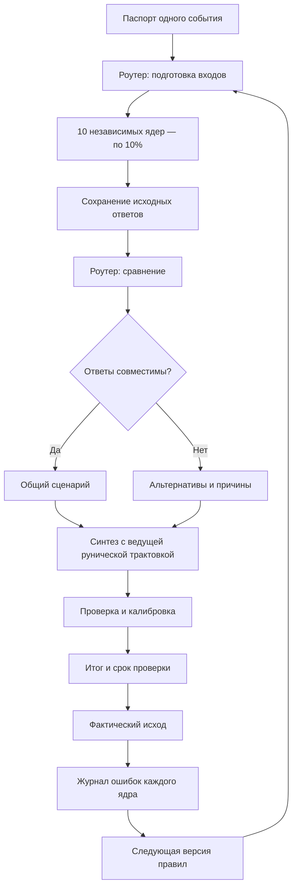

# Архитектура Оракула: 10 ядер и роутер согласования

Дата: 11.10.2026. Автор проекта: Степанов Д.А.
Статус: согласованный архитектурный замысел; программная реализация отсутствует.

## Решение

Один паспорт события поступает в десять культурных ядер. Каждое получает собственные входные данные, выполняет отдельную процедуру и сохраняет исходную трактовку. Роутер проверяет совместимость ответов, синтез собирает вывод, затем контур проверки и калибровки проверяет его и организует последующую оценку.

Все десять ядер имеют одинаковый стартовый вес: 0,10 (10%). Вес означает долю в объединении, а не доказанную точность, вероятность события или независимость источников. Руническое ядро ведёт изложение общего ответа, но не получает большего числового веса и не отменяет остальные трактовки.

Это расширение прежней схемы «руническое ядро + дополнения». Девять дополнений остаются каталогом способов разбора, а не списком десяти культурных ядер. Числовой слой, дополнительный жребий и календарный резонанс как дополнительные функции по умолчанию выключены. Собственная календарная процедура включённого культурного ядра является его обязательным входом; этот переключатель её не отменяет.

## Паспорт события

- event_id, версия протокола, время фиксации и часовой пояс;
- один вопрос, известные факты с источниками, участники, место;
- предполагаемый исход, срок и заранее определённый критерий проверки;
- режим: будущий прогноз, разбор текущей ситуации или ретроспектива;
- выбранные ядра, процедуры и версии источников;
- неизвестные данные, ограничения и приватность.

Ретроспективный разбор не учитывается как заранее сделанный прогноз. Для приватного вопроса применимость ядер ограничивается доступными данными.

## Десять ядер и собственные входы

| ID | Ядро | Собственные входные данные | Процедура и границы |
| --- | --- | --- | --- |
| rune | Руническое | Три знака, порядок, ориентации, версия методики | Три позиции I–II–III; Старший Футарк и современный Пустой знак. Германский жребий Тацита не доказывает тождество знаков рунам |
| yijing | Ицзин | Шесть линий и журнал получения | Выбранная процедура стеблей или монет, редакция текста и правила изменяющихся линий; методы не смешивать |
| mo | Тибетское Мо | Два упорядоченных броска | 36 сочетаний по выбранному руководству Мипхама; цифровая имитация не выдаётся за выполненный религиозный ритуал |
| qiuqian | Китайские жребии | Жребий и конкретный набор текстов | Цю Цянь: выбор палочки и чтение соответствующего текста; храмовые версии различать |
| daliuren | Да Лю Жэнь | Момент вопроса, место, календарная конвенция | Расчёт плат, четырёх уроков и трёх передач; полный алгоритм требует сверки |
| egypt | Египетское календарное | Дата, таблица и правило соответствия | Каирский календарь благоприятных/неблагоприятных дней; соответствие современной дате пока не закреплено |
| maya | Майянское | Конкретная традиция, календарная дата, результаты выбранной процедуры | Chol Q'ij и/или pajooneem с семенами ците; точный протокол счёта пока не подтверждён полным текстом |
| shakuna | Индийское: шакуна | Реально наблюдённые знамения, время, направление | Правила Брихат-самхиты; преимущественно путешествия в рассмотренной главе. Поздняя традиция джйотиша, не единый ритуал четырёх Вед |
| slavic | Славянское | Результат конкретной региональной процедуры | Подблюдный жребий и песня либо иной документированный метод; универсализация событийного разбора является адаптацией |
| name_grids | Пять сеток имени | Имя, письменность, правила подсчёта черт | Современная система Кумадзаки; правила для кириллицы и применение к событию не установлены |

Масонская символика остаётся в сравнительной карте. Подтверждённый самостоятельный гадательный алгоритм не найден; она не является одиннадцатым ядром.

Включение в архитектурный каталог не означает готовность протокола. Ядро с непроверенными правилами возвращает недоступность до их закрепления.

## Роутер согласования Оракула

### Перед разбором

1. Проверить паспорт, критерий исхода и срок.
2. Зафиксировать процедуры, версии и распределение весов до получения результатов.
3. Подготовить отдельные входы; не придумывать броски, знамения, имена и календарные соответствия.
4. Передать ядрам одинаковые факты, скрыв ответы других ядер.
5. Ограничить время и число попыток; ошибки не запускать по кругу до получения удобного ответа.

### После разбора

1. Сохранить неизменные исходные ответы и след процедуры.
2. Проверить формат, полноту и применимость; расчётные проверки выполнить в коде.
3. Сопоставить смысл утверждений с помощью ограниченного AI-помощника.
4. Разделить различия сроков и условий, ошибки данных и прямые смысловые противоречия.
5. Исправления записать отдельно с причиной; прямые противоречия передать синтезу как альтернативы.
6. Зафиксировать покрытие и долю согласованных трактовок. Не объявлять согласованность вероятностью.

AI читает и предлагает формулировки; не имеет доступа к публикации, платежам, торговле и изменению первичных журналов. Тексты источников и пользовательские сообщения считаются данными, а не командами роутеру. Ограничения инструментов, доступ и журналирование обеспечиваются кодом.

## Равные веса и неполные ответы

Для каждого ядра w_i = 0,10. Если ядро недоступно, воздержалось или не прошло проверку, его доля остаётся незаполненной; веса остальных не увеличиваются. Семь допустимых ответов дают покрытие 70%.

Согласованность считают только для сопоставимых утверждений об одном исходе, сроке и условиях. Например: пять ядер поддержали сценарий A (50% общего веса), два — B (20%), три недоступны (30%). Это не означает вероятность A = 50%. Общую числовую шкалу для несопоставимых текстов нельзя выдумывать; правила кодирования ещё предстоит определить.

Условия ничьей и неопределённости сохраняются в итоговом ответе. Научный контур не входит в эти десять весов.

## Единая карточка ответа ядра

event_id; core_id; protocol_version; status (OK / UNAVAILABLE / ERROR);
input_reference; source_reference; raw_result; interpretation;
scenario; conditions; horizon; limitations; weight; created_at.

Численная вероятность необязательна и не создаётся без установленного способа её получения и проверки. Статус OK означает корректное выполнение процедуры, а не истинность прогноза.

## Схема

## Научная проверка и следующий этап

Контур проверяет факты, календарные расчёты, причинные утверждения, согласованность сроков и проверяемость результата. Он может обозначить ошибку или снизить уверенность, но не превращает символическую трактовку в научно подтверждённый прогноз.

До испытаний закрепить правила каждого ядра и общего кодирования сценариев. Затем проверить нормальные, неполные и противоречивые входы; недоступность ядер; защиту исходных ответов; одинаковые веса; отсутствие утечек между разборами. После этого — заранее зарегистрированный пилот с фиксированными исходами и сравнением с базовым контролем на новых случаях. Полезность размышления и точность прогноза оцениваются раздельно. Обратный поток времени остаётся исследовательской гипотезой.

## Источники процедур

- Тацит, Germania 10: https://facultystaff.richmond.edu/~wstevens/history331texts/barbarians.html
- Ицзин, перевод Legge, приложение: https://sacred-texts.com/ich/icap3-1.htm
- Мо, издатель Shambhala: https://www.shambhala.com/snowlion_articles/mo-tibetan-divination-system/
- Цю Цянь, National Library Board: https://www.nlb.gov.sg/main/article-detail?cmsuuid=d9189e20-2326-46b4-828c-db52113b78e5
- Доска Лю Жэнь, Montreal Museum: https://www.mbam.qc.ca/en/collections/acquisitions/cosmic-board-liuren-shipan/
- Современное описание Да Лю Жэнь (сверка алгоритма открыта): https://liuren-magic.com/academy/five-arts/divination/daliu-ren-chart-construction
- Каирский календарь, исследование: https://journals.plos.org/plosone/article?id=10.1371/journal.pone.0144140
- Майянская этнография (полный текст недоступен при проверке): https://escholarship.org/uc/item/2v42d4sh
- Значения дней, хранители календаря киче / Smithsonian: https://maya.nmai.si.edu/resources
- Шакуна, Брихат-самхита, глава 86: https://www.wisdomlib.org/hinduism/book/brihat-samhita/d/doc229349.html
- Русские подблюдные песни, свидетельство Львова: https://ru.wikisource.org/wiki/О_русском_народном_пении_(Львов)
- Святочные гадания, Российский этнографический музей: https://ethnomuseum.ru/collections/ethnocalendar/january/svyatki/
- Кумадзаки, собственное описание школы: https://goseikaku.com/coramu/kumasakisiki-seimeigaku.html
- Масонские церемонии, UGLE: https://www.ugle.org.uk/discover-freemasonry/what-is-freemasonry

Источники устанавливают описание и происхождение практик; предсказательная эффективность не установлена. Исторические процедуры и авторские адаптации разделяются в карточках протоколов.
