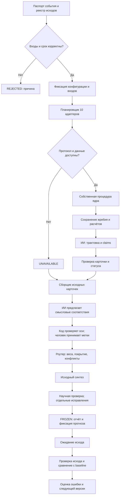
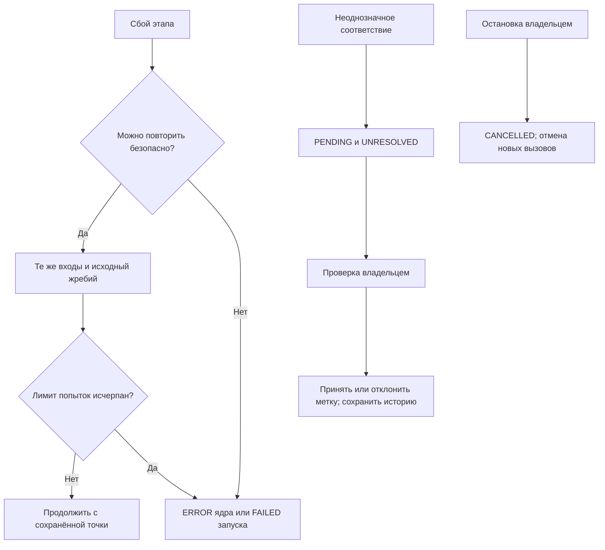

# Схема движка Оракула — проект реализации

Дата: 12.10.2026. Владелец: Дмитрий Степанов. Статус: целевая схема движка. Ограниченная первая реализация v0.1 выполнена: импорт карточек, роутер, журнал и категориальная оценка. Вызовы традиционных процедур, LLM, полный планировщик и научная проверка источников ещё не подключены. Фактические границы: [ENGINE_V0_1.md](ENGINE_V0_1.md).

## Цель

Наша цель — создать Оракул, объединяющий символические традиции и научную проверку, чтобы исследовать возможность предсказания будущего со снижением измеряемой ошибки, проверить гипотезу обратного потока времени и выяснить природу удачи, отличая её от случайности.

Основание: [контракт согласования](ARCHITECTURE_10_CORES.md). Состав десяти ядер и веса 0.10 сохраняются. Диаграмма показывает основной поток; ожидание исхода не блокирует новые независимые события.

## Основная схема

## Разделение ответственности

- **Контроллер на Python:** состояния процесса, доступ, валидация, версии, таймауты, бюджет и повторы. Минимальный прототип — библиотека и CLI; API/Telegram/n8n подключаются позже как интерфейсы.
- **Адаптеры традиций:** rune, yijing, mo, qiuqian, daliuren, egypt, maya, shakuna, slavic, name_grids. Каждый использует закреплённый протокол и собственные входы, не получает чужие ответы. Неопределённый протокол возвращает UNAVAILABLE.
- **Жребий и расчёты:** программный RNG или зафиксированный ввод человека. ИИ не придумывает броски, календарную дату, наблюдённые знамения или число черт имени. Рунный выбор сохраняет закрытый набор, ориентации и commitment до выбора; раскрытие всех трёх после завершения выбора. Хеш не доказывает прогнозную способность.
- **ИИ:** читает утверждённые источники, формулирует трактовку и предлагает смысловые соответствия с указанием исходных фрагментов. Не меняет веса, оригиналы, исходы и правила оценки. Не запускает произвольный код и не выполняет внешние действия.
- **Роутер:** считает только принятые сопоставления. В первом пилоте смысловые метки проверяет человек. PENDING сохраняется как UNRESOLVED; непроверенные соответствия не создают численного лидера.
- **Сервис журнала:** единственный путь записи первичных результатов. В прототипе SQLite с транзакциями и запретом обновления/удаления записей на уровне сервиса; экспорт JSON/Markdown. Для криптографически проверяемой истории нужны дополнительно цепочка хешей и независимая фиксация. Простая SQLite не объявляется защищённой от администратора.
- **Оценщик:** проверяет реальные исходы, считает заданную до запуска метрику, сравнивает исходный и проверенный прогнозы с одним baseline; полезность рефлексии хранит отдельно.

## Карточки и состояния

Run: event_id, run_id, target_id, mode, created_at, cutoff_at, horizon, timezone, config_version, protocol_versions, source_versions, baseline_version, metric_version, inputs_hash, state.

CoreResult: core_id, status, reason_code, raw_result_ref, procedure_trace_ref, input_hash, interpretation, claims, limitations. Статусы: OK / ABSTAIN / UNAVAILABLE / ERROR. Вес поступает из конфигурации, не из ответа ИИ.

Claim: claim_id, source_fragment, type (FACT / SYMBOLIC / FORECAST / ADVICE), scenario_id, condition_id, horizon, polarity. Семантическое соответствие имеет отдельный статус PENDING / ACCEPTED / REJECTED.

Основные состояния: RECEIVED → VALIDATED → DISPATCHED → COLLECTED → COMPARED → SYNTHESIZED → CHECKED → FROZEN. REJECTED, FAILED и CANCELLED — отдельные исходы запуска. Проверка последующего события хранится отдельно: WAITING_OUTCOME / OUTCOME_REVIEW / EVALUATED / OUTCOME_UNKNOWN. Отсутствующий исход не считается ни попаданием, ни промахом.

## Ошибки и возобновление

Идемпотентность задаётся run_id + stage + core_id + version. Повтор не создаёт новый жребий и не переписывает исходный ответ. Изменение входов или новый расклад создаёт новый запуск. Модельные ответы фиксируются, а не запрашиваются повторно ради удобного чтения. Таймауты и максимальное число попыток задаются до запуска; конкретные значения выбираются по измерениям прототипа.

## Подсчёт и заморозка

Одна ось = событие, срок и условия. Один core_id даёт не более 0.10 по оси. Недоступные доли не перераспределяются. Процедурное покрытие и покрытие сравнения выводятся раздельно. ALIGNED / MIXED / TIE / UNRESOLVED / NO_COMPARABLE_DATA следуют контракту архитектуры; TIE также может быть дополнительным флагом MIXED. Поддержка не является вероятностью события.

Сохраняются исходный синтез, проверенный итог, основания исправлений и время фиксации. Поздние сведения не включаются в предварительный прогноз. Если итог сформирован после начала целевого события, запуск маркируется как поздний/ретроспективный и исключается из предварительной оценки. Исправление после FROZEN — новая связанная запись, а не замена старой.

## Эксперимент с числами

Экспериментальная функция преобразования расклада в числа — отдельный версионируемый адаптер, не историческая процедура традиции и не научная модель времени. Прежние варианты SHA-256 сохраняются для воспроизводимости. До исхода задаются игра, номер тиража и точное время с часовым поясом. Тираж 46158: заранее объявленная комбинация 3,13,14,19 / 2,3,5,20; источник фиксации — переписка 12.10.2026, без утверждения о созданном внешнем журнале.

Для будущего испытания фиксируются тип событий, метрика, baseline, объём и правило остановки. Новые варианты не подбираются по известным исходам. Тесты роутера на искусственных карточках проверяют реализацию, но не доказывают предсказательную эффективность. Гипотеза обратного потока времени требует самостоятельного экспериментального дизайна; число совпадений её не удостоверяет.

## Последовательность сборки

1. Контракты данных, контроллер и журнал на искусственных карточках.
2. Детерминированный роутер и обязательные случаи T01–T18 из архитектуры.
3. Закреплённые процедуры рун и Ицзин; остальные адаптеры по готовности протоколов.
4. Ограниченный смысловой ИИ и ручная приёмка сопоставлений.
5. Научные проверки, фиксация прогноза и оценщик исходов.
6. Независимая проверка на будущих событиях; интерфейс после приёмки основного пути.

Критерий готовности схемы: основной путь, ветви недоступности/ошибки/остановки, правила записи, ручная семантическая проверка и последующий исход заданы. Критерий готовности движка: реализованный код и выполненные проверки; для первой ограниченной версии он описан в ENGINE_V0_1.md; полная схема ещё не реализована.
