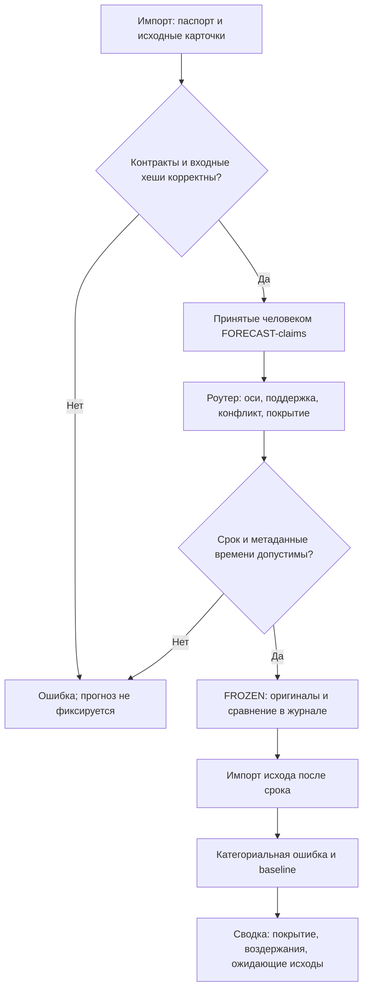

# Универсальный движок v0.1

Дата: 12.10.2026. Python 3.11+, стандартная библиотека. Это первая реализация программного ядра, а не весь целевой движок.

## Реальный маршрут



Нет вызовов моделей, выполнения процедур адаптеров, синтеза и проверки содержимого научных источников. `state_trace` — стадии одного атомарно сохраняемого импорта; это не полноценный распределённый планировщик с контрольными точками каждой стадии. Восстановление v0.1 означает повторное использование уже замороженного результата при идентичных входах.

## Запуск

```bash
python -m unittest discover -v
python -m dis_oracle compare examples/mixed.json
python -m dis_oracle freeze examples/aligned.json --run-id demo-1 --db private-runs/demo.sqlite --markdown private-runs/demo-1.md
python -m dis_oracle evaluate examples/outcome.json --run-id demo-1 --db private-runs/demo.sqlite
python -m dis_oracle verify --db private-runs/demo.sqlite
python -m dis_oracle summary --db private-runs/demo.sqlite
python -m dis_oracle export --db private-runs/demo.sqlite
```

Примеры вымышленные. Сценарии A/B не являются готовой универсальной шкалой традиций. `analysis` не учитывается в предварительной оценке. Для настоящего прогноза нужна своя карточка события с будущим deadline, режимом forecast, заранее установленными непересекающимися критериями и baseline. При `question: null` содержание приватного вопроса не сохраняется; сведения, которые пользователь сам вложил в facts/cards, остаются в локальном журнале.

## Контракт входа

`compare` и `freeze` принимают объект с `event` и `cards`; полный пример — `examples/mixed.json`.

Event:
- event_id, question (строка или null), mode: forecast / analysis / retrospective;
- cutoff_at — последняя допустимая дата доступности фактов, с часовым поясом;
- facts: text, source, available_at; код отвергает available_at после cutoff;
- axes: axis_id, condition_id, deadline, scenarios и baseline;
- scenario: scenario_id и criterion. Критерии задаёт владелец до запуска; программа проверяет структуру и уникальность, но не доказывает их смысловую взаимоисключаемость;
- baseline — зарегистрированный scenario_id, зафиксированный вместе с событием. Это простой категориальный контроль v0.1, не полнофункциональная вероятностная модель.

Одинаковые condition_id и deadline не допускаются под разными axis_id. Разные условия и сроки сравниваются отдельно.

CoreResult:
- core_id из утверждённых десяти ID;
- status: OK / ABSTAIN / UNAVAILABLE / ERROR; reason обязателен для non-OK;
- protocol_version, inputs, input_hash = SHA-256 канонического JSON inputs;
- raw_result, interpretation и claims.

Claim:
- claim_id, type: FORECAST / SYMBOLIC / FACT / ADVICE;
- text, source_fragment (должен входить в исходную interpretation);
- axis_id, scenario_id, polarity: SUPPORT / OPPOSE / UNSPECIFIED;
- review_status: PENDING / ACCEPTED / REJECTED;
- reviewed_by и reviewed_at для ACCEPTED/REJECTED. Личность рецензента не аутентифицируется в локальном прототипе.

Голосуют только принятые FORECAST-claims валидного OK-ядра. Фрагмент не доказывает достоверность источника; весь исходный текст импортируется и сохраняется. Нельзя выдать импорт искусственной карточки за выполненный исторический ритуал.

## Роутер

Все веса 0.10. Пропущенные ядра явно UNAVAILABLE / NOT_SUPPLIED. Процедурное покрытие — доля OK; покрытие сравнения — уникальные ядра с принятыми SUPPORT/OPPOSE по оси. Синонимы не увеличивают вес. Внутренне противоречивое ядро исключается из голосов по оси с сохранением причины.

NO_COMPARABLE_DATA → UNRESOLVED → MIXED → TIE → ALIGNED — приоритет статусов. MIXED сохраняет флаг TIE при равной максимальной поддержке. PENDING скрывает лидеров; несколько несовместимых сценариев не усредняются. OPPOSE не преобразуется в произвольную поддержку другого сценария; при отсутствии положительной поддержки прогноз отсутствует.

Автоматический категориальный prediction выдаётся только для ALIGNED с одним лидером. Один голос означает покрытие 10%, а не согласие десяти традиций. Процент поддержки не записывается как вероятность.

## Журнал, время и исход

SQLite-транзакция сохраняет один замороженный запуск с исходными входами, карточками и результатом. Уникальный ключ не может получить другое содержание. Сервис и триггеры запрещают UPDATE/DELETE; цепочка хешей проверяется при записи и чтении. Повторный вызов после перезапуска возвращает прежнюю запись. Администратор может переписать всю БД; независимой отметки времени нет.

CLI использует текущее время машины для freeze/evaluate. Внутренние Python-функции принимают явно заданное время для искусственных испытаний; это не механизм независимой аттестации. Для реального исследования нужно доверенное время, изоляция исходов и внешняя фиксация хеша.

Outcome: event_id, axis_id, scenario_id, source, observed_at. Наблюдение должно быть не раньше зарегистрированного deadline и не позже времени оценки. Предварительная оценка доступна только для forecast. Отказ от ответа имеет error=null, а не автоматически ошибку 1. Сводка отдельно показывает ожидающие исходы, воздержания и baseline на той же оценённой выборке.

Метрика v0.1 — 0/1 ошибка категориального прогноза. Частичные совпадения лотерей, Брайер, интервалы неопределённости и анализ обратного времени не реализованы. Правильность исхода и критерия проверяет владелец; `source_verified` остаётся false.

## Проверки и следующие этапы

Тесты покрывают согласие/конфликт, равные веса и отсутствие перераспределения, разные оси, дубликаты, неподтверждённые claims, подмену фрагментов, невалидные хеши, поздние данные, повтор и перезапуск, блокировку изменения журнала, обнаружение повреждения, оценку/воздержание и исключение ретроспективы. Это проверки реализации, а не предсказательной эффективности.

Далее: закреплённые адаптеры рун/Ицзин; отдельный сервис жребия; API ручной приёмки; ограниченная LLM-интерпретация; синтез и независимые научные проверки; контрольный перспективный эксперимент. FAIL/CANCEL/timeout и журнал промежуточных вызовов будут нужны при появлении исполняемых адаптеров; сейчас импорт не вызывает внешние сервисы.
