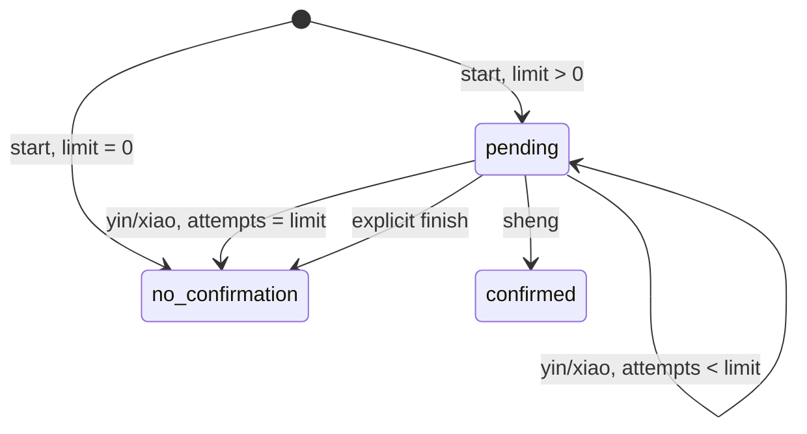

# Мо и Гуань Инь: механические сессии v1

17.10.2026. Реализованы **числовая механика и постоянное хранение**, а не
полные исторические ядра. Исходная ветка `codex/mo-qiuqian-v4-review`,
проверенный HEAD `15a75510b67ad7aff2d1ba2d0a4a41a3e348ecbd`.
Материалы `research/qwen/mo_qiuqian_v4_UNVERIFIED` сохранены без изменений;
их заявления о готовности и ожидаемые ответы не использованы как эталон.

## API и режимы

Python 3.11+, стандартная библиотека, новых зависимостей нет.

```python
from dis_oracle.adapters.mo import MoSessions
from dis_oracle.adapters.qiuqian import QiuqianSessions

# Использовать НОВЫЙ файл для механических сессий, не прежний журнал движка.
with MoSessions("private-runs/new-mechanics.sqlite") as sessions:
    card = sessions.run("mo-1", "event-1", mode="manual",
                        first_throw=3, second_throw=5)

with QiuqianSessions("private-runs/new-mechanics.sqlite") as sessions:
    initial = sessions.start("qq-1", "event-1", mode="manual",
                             stick_number=42, max_attempts=2)
    observed = sessions.confirm("qq-1", "event-1", "obs-1", "yin_bei")
    final = sessions.confirm("qq-1", "event-1", "obs-2", "sheng_bei")
    assert final == sessions.status("qq-1", "event-1")
```

- `manual`: только введённые значения, без RNG. Мо требует оба целых броска
  1–6. Гуань Инь требует целый номер 1–100; отсутствие подтверждения при
  `start` означает **явную фазу ожидания**, а не разрешение его сгенерировать.
  `confirm` требует одно из `sheng_bei`, `yin_bei`, `xiao_bei`.
- `digital`: `secrets.SystemRandom`, ручные значения должны отсутствовать.
  Любой переданный бросок/номер/результат подтверждения в этом режиме —
  `ContractError`, даже если он совпал бы с результатом генерации.
- `historical`: `ContractError` с `BLOCKED_SOURCE`. Нельзя получить процедуру
  Kwan Im Thong Hood Cho Temple, сменив только подпись цифровой модели.
- bool вместо int, float, строки, неверные диапазоны и частичный ввод Мо
  отклоняются до генерации. Режим обязателен. Непустые event_id/session_id
  проверяются; все SQL-запросы параметризованы.

Мо возвращает два **упорядоченных** числа и локальный идентификатор
`mo-a-b`: ровно 36 пар. Это механический ID, не название традиционного
толкования. Соответствие чисел слогам, названия и значения не заполняются.

## Гуань Инь: определённая здесь авторская модель

Набор `author-numeric-100-v1` содержит все целые 1–100 **по определению
цифровой адаптации**. Это не подтверждение реального состава храмового
набора или наличия в нём номера 100. В `inputs` записаны `temple=null`,
отдельный `research_target_temple` и `AUTHOR_ADAPTATION_NOT_HISTORICAL`.
Контекст Guanyin и все эти метаданные входят в `input_hash`.

Номер выбирается **один раз** при `start` и сохраняется всю сессию. Автоматического
нового жребия после отрицания/неясности нет в обоих режимах. Новая палочка
требует новой session_id. Это сознательный выбор авторской модели, не
заимствованное правило выбранного или другого храма.

`max_attempts` — **общее число попыток подтверждения**, включая первую;
не число дополнительных повторов. Допустимы целые 0–1000, bool запрещён.
Верхняя граница — технический предел, не историческое правило.

- `0`: палочка сохраняется/выбирается, бросков подтверждения нет,
  `no_confirmation`. Переданное вместе с нулевым лимитом наблюдение
  отклоняется: данные не отбрасываются молча.
- `1`: максимум один результат; отрицание/неясность сразу завершает сессию.
- `3`: максимум три результата, никогда не четыре. Успех на третьем
  даёт `confirmed`, отрицание на третьем — `no_confirmation`.

`start` цифрового режима сохраняет номер и состояние ожидания. Каждый
`advance(session_id, event_id, request_id)` генерирует ровно **одну** попытку
из двух сторон, сразу сохраняя результат. Нет скрытого цикла до успеха.
В ручном режиме аналогично добавляется только явно переданный `confirm`.
Первое наблюдение можно также передать аргументом `confirmation_result`
в ручной `start`; оно считается первой попыткой.



`finish(..., request_id)` явно завершает ожидание без подтверждения.
Он не придумывает новую попытку и сохраняет уже введённые наблюдения.
После терминального состояния новые команды отклоняются; точный повтор
ранее выполненной команды по-прежнему возвращает её результат.

Цифровое моделирование: две **независимые равновероятные** стороны,
`0=convex`, `1=flat`. Четыре равновероятные пары:

| Стороны | Метка модели | Вероятность модели |
| --- | --- | --- |
| 0,0 | yin_bei | 1/4 |
| 0,1 и 1,0 | sheng_bei | 1/2 |
| 1,1 | xiao_bei | 1/4 |

Это математическое допущение, не измерение физических 筊杯 и не
«традиционные вероятности» Kwan Im Thong Hood Cho Temple.
Оба сгенерированных значения сторон сохраняются. Для ручного результата
`sides=null`: неизвестные ориентации не восстанавливаются по догадке.

## Идемпотентность, история и восстановление

Новый `mechanical_steps` хранит неизменяемые команды и полные снимки карточек
в отдельной SQLite-БД. Один файл может содержать оба адаптера; пространство
session_id раздельное по core_id, привязка к event_id неизменна.
Старый журнал движка не мигрируется: открытие посторонней БД этим API
отклоняется до создания таблиц. Новые файлы на POSIX получают режим 0600.

Изначальные параметры режима, номера, лимита и event_id нельзя менять.
Для создания зарезервирован request_id=`start`; каждый дополнительный
запрос получает собственный непустой request_id. Повтор **той же команды**
с теми же данными возвращает её исходный снимок, включая времена/жребий.
Изменённые данные или другой вид операции под тем же request_id отклоняются.
Новые ручные наблюдения — отдельные добавленные команды, не редактирование
старого ввода. Их полная последовательность входит в `inputs.requests`.

После продолжения повтор `start` возвращает **начальный** снимок;
`status(session_id,event_id)` возвращает **последний**. Это различие важно:
повтор HTTP/CLI-команды не становится новым наблюдением.

`BEGIN IMMEDIATE` берётся до чтения/генерации: два писателя с одной командой
не получают два жребия. Успешный вызов возвращается после атомарного commit.
Повтор после закрытия/открытия БД не меняет номер, стороны, историю и карточку.
Незавершённая транзакция при сбое откатывается; гарантия восстановления
относится к зафиксированным командам, не к незафиксированной работе процесса.
Ошибочные запросы не меняют сессию.

SQL-триггеры запрещают UPDATE/DELETE. Цепочка хешей проверяется при чтении
и перед добавлением. Это защита от обнаруживаемого изменения записей,
не независимая аттестация времени и не защита от администратора,
переписывающего всю БД. Файлы сессий не публикуются в Git.

## Совместимость карточек

Контракт **не изменён**. Используются девять действующих полей CoreResult;
дополнительные состояния размещены внутри разрешённого `raw_result`.
Каждая создаваемая карточка, включая ожидание и отказ, проходит
`dis_oracle.contracts.validate_cards`; `input_hash=digest(inputs)` от
**всего** объекта, без выборочного списка полей.

| Состояние механики | raw_result.procedure_status | CoreResult.status / reason |
| --- | --- | --- |
| Мо completed | OK | ABSTAIN / TEXT_CORPUS_NOT_FIXED |
| qiuqian pending | PENDING | ABSTAIN / PROCEDURE_PENDING |
| qiuqian confirmed | OK | ABSTAIN / TEXT_CORPUS_NOT_FIXED |
| qiuqian no_confirmation | OK | ABSTAIN / CONFIRMATION_NOT_RECEIVED |

`OK` внутри механики означает корректно обработанную процедуру, а не
историческую аутентичность, полученное одобрение или правильность прогноза.
`interpretation_status=ABSTAIN`, `text_corpus=UNAVAILABLE`, `claims=[]`
во всех карточках. Действующий роутер не превращает их в голоса;
веса 0.10 и правила покрытия не меняются. Вынесенный CLI описан в
[отчёте с фактическими проверками](MO_QIUQIAN_REPORT.md).
